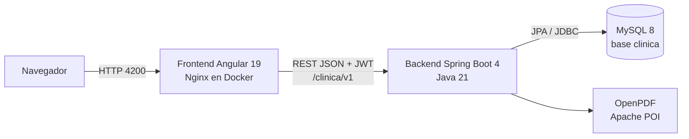

# Documentación técnica — Clínica Veterinaria Uniminuto

Sistema web full stack para la gestión administrativa, médica y financiera de una clínica veterinaria
(examen final de Programación Web Full Stack).

| Documento | Contenido |
|---|---|
| Este archivo | Instalación, arquitectura, API, reglas de negocio y evidencias |
| [MODELO_DATOS.md](MODELO_DATOS.md) | Diagrama entidad-relación, restricciones y justificación de los cambios |
| [CREDENCIALES_PRUEBA.md](CREDENCIALES_PRUEBA.md) | Usuarios de prueba por rol (no son credenciales reales) |
| Swagger UI | `http://localhost:8080/clinica/v1/swagger-ui.html` (con el backend en ejecución) |

## 1. Instalación y ejecución

### Opción A: Docker Compose (recomendada)

Requisitos: Docker Desktop (o Docker Engine con el plugin Compose).

```bash
docker compose up --build
```

| Servicio | URL |
|---|---|
| Aplicación | <http://localhost:4200> |
| API | <http://localhost:8080/clinica/v1> |
| Swagger | <http://localhost:8080/clinica/v1/swagger-ui.html> |
| MySQL | `localhost:3307`, base `clinica` |

- La primera vez, el contenedor de MySQL crea la base con `backend/database/clinica.sql`.
- El backend arranca con el perfil `dev` y crea los usuarios de prueba por rol.
- Las contraseñas de la base tienen valores por defecto de desarrollo. Para cambiarlas, cree un archivo `.env`
  junto a `docker-compose.yml` con `DB_USUARIO`, `DB_CLAVE` y `DB_CLAVE_ROOT`.
- Para empezar desde cero, borre el volumen de datos:

  ```bash
  docker compose down -v
  ```

### Opción B: ejecución local

Requisitos: Java 21, MySQL 8 y Node.js 20 o 22.

1. **Base de datos:** cree la base y el usuario, e importe `backend/database/clinica.sql`:

   ```sql
   CREATE DATABASE clinica CHARACTER SET utf8mb4 COLLATE utf8mb4_unicode_ci;
   CREATE USER 'clinica'@'localhost' IDENTIFIED BY '<clave>';
   GRANT ALL ON clinica.* TO 'clinica'@'localhost';
   ```

   La clave debe coincidir con `spring.datasource.password` de `application-dev.properties`.

2. **Backend:** desde la carpeta `backend`:

   ```bash
   ./mvnw spring-boot:run
   ```

3. **Frontend:** desde la raíz del proyecto:

   ```bash
   npm install
   npx ng serve --port 4200
   ```

   Abra <http://localhost:4200> e inicie sesión con un usuario de `CREDENCIALES_PRUEBA.md`.

**Base existente:** si ya tenía la base del segundo parcial, aplique `backend/database/migracion_examen_final.sql`
en lugar de importar el volcado completo.

## 2. Arquitectura



### Frontend (`src/app`)

- Angular 19 con componentes standalone, formularios reactivos y Bootstrap 5 (plantilla Datta Able).
- El menú lateral se construye con los menús del perfil que devuelve el login.
- `guards/` protege las rutas: sesión activa y menú permitido.
- `interceptors/` cierra la sesión si el backend responde 401.
- Cada módulo está en `demo/pages/<modulo>` con su componente y su servicio. Los servicios generales están en
  `services/` y los modelos TypeScript en `models/`.
- Librerías: FullCalendar (calendario) y SweetAlert2 (mensajes).

### Backend (`backend/src/main/java/com/uniminuto/clinica`), organizado por capas

| Paquete | Responsabilidad |
|---|---|
| `api` | Interfaces REST: rutas, parámetros y documentación OpenAPI |
| `apicontroller` | Implementación de las interfaces; delega en los servicios |
| `service` / `serviceimpl` | Reglas de negocio y transacciones |
| `repository` | Spring Data JPA, consultas y bloqueos |
| `entity` | Entidades JPA |
| `models` | Objetos de petición (`Rq`) y respuesta (`Rs`) |
| `config` | Seguridad JWT, CORS, OpenAPI y usuarios de prueba |
| `exception` | Errores en JSON con su código HTTP (400, 401, 403, 404, 409) |
| `util` | Usuario actual, paginación, validaciones, dinero, PDF (OpenPDF) y Excel (Apache POI) |

### Seguridad

- `POST /auth/login` entrega un token JWT firmado con HS256.
- En cada petición el perfil del usuario se lee de la base, de modo que un cambio de perfil o una inactivación
  aplican de inmediato.
- La matriz de permisos por ruta está en `config/SeguridadConfig`. Los servicios además validan la propiedad de
  los datos; por ejemplo, un veterinario solo modifica sus propias citas y atenciones.
- El frontend solo oculta las opciones; el control real está en el backend.

## 3. Servicios de la API

La documentación completa e interactiva está en Swagger: 114 operaciones agrupadas por módulo. Para probarlas,
ejecute `POST /auth/login`, copie el token y péguelo en "Authorize".

| Módulo | Ruta base | Perfiles |
|---|---|---|
| Autenticación | `/auth` | Todos |
| Perfiles y menús, usuarios | `/perfil`, `/usuario` | Administrador |
| Clientes, mascotas | `/cliente`, `/mascota` | Administrador y recepción (el veterinario consulta) |
| Especialidades, veterinarios y horarios, razas | `/especializacion`, `/medico`, `/raza` | Consultan todos; modifica el administrador |
| Citas y calendario | `/cita` | Administrador, recepción y veterinario (solo sus citas) |
| Inventario | `/medicamento` | Consultan administrador, veterinario y despacho; modifica el administrador |
| Carga masiva | `/medicamento/carga` | Administrador |
| Historias, anotaciones, fórmulas | `/historia`, `/anotacion`, `/formula` | Registra el veterinario; consulta el administrador |
| Atención médica | `/atencion` | Veterinario (la prefactura también administración y recepción) |
| Despacho | `/despacho` | Despacho médico (el administrador consulta el historial) |
| Tarifas | `/servicio` | Consultan todos los que atienden y facturan; modifica el administrador |
| Facturación | `/factura` | Administración y recepción; anula solo el administrador |
| Reportes | `/reporte` | Financieros e inventario: administrador. Gestión médica: también recepción |

## 4. Reglas de negocio principales

### Inventario y carga masiva

- **Producto:** código único de 8 caracteres alfanuméricos y nombre único. El registro Invima es obligatorio
  para medicamentos y opcional para insumos.
- **Existencias por lote:** cada lote tiene precio de compra y vencimiento propios. La cantidad disponible es la
  suma de los lotes vigentes. No se reciben lotes vencidos.
- **Alertas:** agotado, stock bajo (por debajo del mínimo) y próximo a vencer (60 días).
- **Ajustes:** cada ajuste exige motivo y queda como movimiento. El inventario nunca queda negativo.
- **Carga masiva:** acepta `.xlsx` o `.csv` (separado por coma o punto y coma), hasta 5 MB y 5000 filas.
  - Primero se **valida** sin guardar nada: encabezados, obligatorios, formatos, precios, cantidades, fechas
    y duplicados (en el archivo y contra la base).
  - Se muestra una **vista previa** con la fila y el motivo de cada error, y un **informe de errores** en Excel.
  - Al **confirmar** se importan solo las filas válidas, cada una en su propia transacción (producto + lote +
    entrada de inventario). Un error en una fila no afecta las demás.
  - **Log de cargue:** cada archivo queda registrado con usuario, fecha y resultado por fila.
  - La plantilla se descarga desde la pantalla. `backend/database/carga_inventario_ejemplo.csv` trae 60
    productos de ejemplo.

### Citas y calendario

- Cada cita tiene inicio y fin.
  - Un veterinario no puede tener dos citas que se crucen, ni una mascota dos citas simultáneas. Las canceladas
    no ocupan horario.
  - No se agendan citas en el pasado, fuera del horario de disponibilidad del veterinario ni con veterinarios
    inactivos.
- **Calendario del veterinario:** vista de mes, semana y día, con colores por estado.
  - Para agendar se selecciona un espacio libre; para reprogramar, se arrastra la cita.
  - El detalle muestra el propietario, la mascota y el historial de citas de la mascota.
- El veterinario solo ve y modifica sus citas. Recepción y administración usan el módulo de gestión de citas.
- **Cancelación:** exige motivo. Toda creación, reprogramación o cambio de estado queda en el historial de la cita.
- **Excel de citas:** se filtra por fechas y por veterinario, e incluye una hoja de resumen por estado.

### Atención médica, fórmulas y facturación

- **Inicio de la atención:** se puede iniciar desde 30 minutos antes de la cita. Al iniciarla se crea la
  historia clínica y se registra la consulta de la especialidad con la tarifa vigente.
- **Finalización:** exige motivo, síntomas y diagnóstico, al menos un servicio y ninguna fórmula en borrador.
  Al finalizar, la cita queda atendida y se genera la prefactura en PDF.
- **Fórmulas:**
  - Solo el veterinario autor las crea, edita y confirma.
  - Tienen de 1 a 20 medicamentos, sin repetir.
  - La cantidad se sugiere a partir de dosis × tomas por día × días.
  - Se anulan con motivo si no tienen entregas.
- **Tarifas:**
  - Las administra el administrador, con IVA.
  - Todo cambio exige motivo y queda en el historial de la tarifa.
  - Solo puede haber una consulta activa por especialidad.
- **Facturación:**
  - **Contenido:** una sola factura vigente por atención finalizada. Los servicios se cobran con la tarifa
    congelada y los medicamentos solo por lo efectivamente despachado.
  - **Valores:** IVA por línea; descuentos solo autorizados por el administrador y con motivo.
  - **Pagos:** parciales o totales, sin superar el saldo. Estados: pendiente de pago, pago parcial, pagada y
    anulada.
  - **Anulación:** solo el administrador, con motivo y sin pagos registrados. La factura anulada se conserva y la
    atención puede volver a facturarse.

### Despacho de medicamentos (perfil `DESPACHO_MEDICO`)

- **Estados de la fórmula:** pendiente de despacho, en preparación, despacho parcial, despachado, pendiente por
  disponibilidad y cancelado. Cada cambio de estado queda en el historial con usuario y fecha.
- **Lotes:** se sugieren primero los de vencimiento más próximo y no se entregan lotes vencidos.
- **Entregas:**
  - Pueden ser parciales y nunca superan lo pendiente ni lo disponible.
  - Cada entrega descuenta el inventario y crea movimientos de salida en una sola transacción, con la fórmula y
    los lotes bloqueados.
- **Reversión:** una entrega confirmada no se borra; se revierte con motivo y las unidades vuelven a sus lotes.
- **Comprobante:** se genera en PDF por cada entrega.

### Reportes

- **Cantidad:** 20 reportes, entre financieros, de inventario y de gestión médica.
- **Filtros:** fechas, agrupación por día, mes o año, veterinario, especialidad, producto, estado y días.
- **Resultado:** vista previa con totales y descarga en PDF o Excel con encabezado, fecha de generación y
  totales.
- **Coherencia:** los valores financieros salen de las facturas (sin las anuladas) y de los pagos registrados.

## 5. Evidencias funcionales (guía para la sustentación)

1. **Carga masiva:**
   1. Inicie sesión como administrador y entre a Inventario → Carga masiva.
   2. Suba `backend/database/carga_inventario_ejemplo.csv` (60 filas).
   3. Revise la vista previa e importe.
   4. Consulte el log de cargas.
2. **Descuento de inventario por dispensación:**
   1. Como veterinario, cree y confirme una fórmula.
   2. Como despacho, prepare la fórmula, confirme la entrega y descargue el comprobante.
   3. En Inventario, revise los movimientos de salida del producto.
3. **Citas en el calendario:**
   1. Como veterinario, entre a Mi calendario.
   2. Agende una cita seleccionando un espacio libre y reprogramela arrastrándola.
   3. Confírmela y descargue el Excel de citas.
4. **Fórmulas y facturas:**
   1. Desde el calendario, pulse Atender y registre la atención con servicios y una fórmula.
   2. Finalice la atención y descargue la prefactura.
   3. Como recepción o administración, facture, registre pagos y descargue la factura en PDF.
5. **Reportes:** en Reportes, elija un reporte, consulte la vista previa y descargue el PDF y el Excel.

## 6. Tecnologías

| Capa | Tecnologías |
|---|---|
| Frontend | Angular 19, TypeScript, Bootstrap 5, FullCalendar 6, SweetAlert2, Font Awesome 6 |
| Backend | Java 21, Spring Boot 4 (Web, Data JPA, Security, OAuth2 Resource Server), Lombok |
| Documentos | OpenPDF (PDF), Apache POI (Excel) |
| API | springdoc-openapi (Swagger UI) |
| Base de datos | MySQL 8 |
| Despliegue | Docker y Docker Compose (MySQL 8.4, Eclipse Temurin 21, Nginx) |
