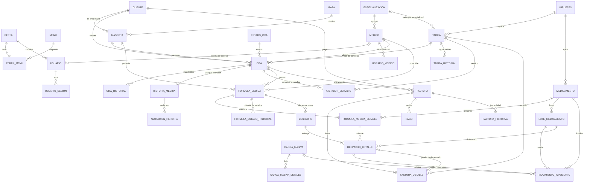

# Modelo de datos

Base de datos MySQL 8 `clinica` (34 tablas). Scripts en `database/`:

| Script | Uso |
|---|---|
| `01_schema.sql` | Creación completa de tablas, llaves foráneas, índices y restricciones `CHECK`. |
| `02_seed.sql` | Perfiles, menús, usuarios de prueba, catálogos y datos de demostración (fechas relativas a `CURDATE()`). |
| `03_migracion_desde_base.sql` | Opcional: transforma `medicamento`, `menu`, `perfil` y `perfil_menu` de la base entregada. |
| `carga_masiva_64_registros.csv / .xlsx` | Evidencia de carga masiva: 64 filas (55 válidas, 9 con errores intencionales). |
| `carga_masiva_54_validos.csv` | 54 filas válidas. |

## Diagrama entidad-relación

Todas las tablas de auditoría (`*_historial`, `movimiento_inventario`, `despacho`, `pago`, `carga_masiva`, `lote_medicamento`) guardan `usuario_id` (FK a `usuario`) y fecha/hora.

## Entidades exigidas por el enunciado

| Requerimiento | Entidades |
|---|---|
| 1. Inventario | `medicamento`, `lote_medicamento`, `movimiento_inventario`, `carga_masiva`, `carga_masiva_detalle`, `impuesto` |
| 2. Citas | `medico` (veterinario), `especializacion`, `horario_medico`, `cita`, `mascota`, `cliente` (propietario), `estado_cita`, `cita_historial` |
| 3. Atención y facturación | `tarifa`, `tarifa_historial`, `impuesto`, `historia_medica`, `anotacion_historia`, `atencion_servicio`, `formula_medica`, `formula_medica_detalle`, `factura`, `factura_detalle`, `pago`, `factura_historial` |
| 5. Despacho | `usuario`, `perfil`, `perfil_menu`, `formula_medica`, `formula_medica_detalle`, `despacho`, `despacho_detalle`, `lote_medicamento`, `movimiento_inventario`, `formula_estado_historial` |

## Restricciones e integridad

**Llaves foráneas.** La base entregada no las tenía porque los tipos no coincidían (`int` contra `bigint unsigned`). En este script todos los tipos de llave coinciden y cada relación tiene su `FOREIGN KEY` (sin borrado en cascada: nada histórico se elimina).

**Únicos relevantes**

| Restricción | Regla de negocio |
|---|---|
| `medicamento.codigo` y `medicamento.nombre` únicos | Identificación del producto (evita duplicados en carga masiva) |
| `lote_medicamento (medicamento_id, numero_lote)` | Un lote no se registra dos veces |
| `historia_medica.cita_id` | Una historia clínica por atención |
| `atencion_servicio (cita_id, tarifa_id)` | No se registra dos veces el mismo servicio en una atención |
| `formula_medica_detalle (formula_id, medicamento_id)` | Un medicamento una vez por fórmula |
| `despacho.clave_idempotencia` | Un reenvío de la misma confirmación no descuenta dos veces el inventario |
| `factura.cita_activa_id` (columna generada: `cita_id` si la factura no está anulada) | Una sola factura vigente por cita; tras anular se puede refacturar |
| `factura_detalle.despacho_detalle_activo` (columna generada) | Un producto dispensado sólo está en una factura vigente |
| `usuario.username`, `usuario.medico_id` | Un usuario por veterinario |

**CHECK (MySQL 8.0.16+)**

| Tabla | Regla |
|---|---|
| `medicamento` | Código `^[A-Za-z0-9]{8}$`; si `requiere_invima = 1` el registro INVIMA es obligatorio; stock y precios no negativos |
| `lote_medicamento` | `0 <= cantidad_disponible <= cantidad_inicial`; vencimiento posterior a la compra |
| `movimiento_inventario` | Cantidad > 0 y saldos >= 0 (nunca negativos); una salida por `DISPENSACION` exige `despacho_id` y `formula_id` |
| `formula_medica_detalle` | Frecuencia 1-168 h, duración 1-365 días, `cantidad_despachada <= cantidad_prescrita` |
| `cita` | `fecha_hora_fin > fecha_hora` |
| `horario_medico` | Día 1-7 y `hora_fin > hora_inicio` |
| `factura`, `factura_detalle`, `pago` | Valores no negativos, pago > 0, descuento 0-100 %, tipo de ítem coherente (servicio con tarifa, producto con despacho) |

## Justificación de los cambios

1. **Medicamento → inventario por lotes.** Se agregó código de 8 caracteres, tipo de producto (medicamento, insumo, utensilio), indicador y número de registro INVIMA (obligatorio sólo cuando aplica), precios de compra y venta, impuesto, stock mínimo, fechas de ingreso y próximo pedido. Las existencias viven en `lote_medicamento` (un mismo medicamento con varios lotes, precios y vencimientos); `medicamento.stock_actual` y `fecha_vence` son un resumen que se recalcula en cada movimiento.
2. **Kardex.** `movimiento_inventario` registra cada entrada/salida con saldo anterior y nuevo, lote, costo, usuario y referencia (fórmula, despacho, detalle o carga). Es la base del historial por medicamento y de los reportes.
3. **Carga masiva con log.** `carga_masiva` (quién, cuándo, archivo, totales, estado) y `carga_masiva_detalle` (cada fila leída, sus errores y el resultado) permiten la vista previa, el informe de errores y la auditoría.
4. **Citas.** Se agregaron hora de fin, tipo de consulta (tarifa), motivo de cancelación y auditoría; los estados pasaron a la tabla `estado_cita` (con color para el calendario). `horario_medico` modela la disponibilidad y `cita_historial` conserva creación, reprogramaciones y cambios de estado (las canceladas nunca se borran).
5. **Fórmula encabezado/detalle.** La tabla original era una fila por medicamento. Ahora `formula_medica` (cita, mascota, veterinario, estado de formulación y estado de despacho) + `formula_medica_detalle` (dosis, frecuencia, duración, cantidad prescrita y despachada, vía, indicaciones). Separa **formulación** de **dispensación**.
6. **Despacho.** `despacho` + `despacho_detalle` registran cada entrega (parcial o total) con el lote usado y el precio vigente; `formula_estado_historial` guarda cada cambio de estado con su responsable; la reversión queda marcada en el despacho y genera movimientos de entrada.
7. **Tarifas e impuestos configurables.** `tarifa` (por tipo de servicio y opcionalmente por especialidad) + `impuesto` + `tarifa_historial` (log). El administrador cambia valores sin tocar código.
8. **Facturación.** `factura` copia la especialidad, valores e impuestos (histórico); `factura_detalle` distingue servicios y productos dispensados; `pago` admite pagos parciales y anulación controlada; `factura_historial` da trazabilidad. Ninguna anulación elimina registros.
9. **Seguridad.** `usuario` (BCrypt) ligado a `perfil`, menús por perfil en `perfil_menu`, sesiones revocables en `usuario_sesion`. Se agregó el perfil `DESPACHO_MEDICO`.
