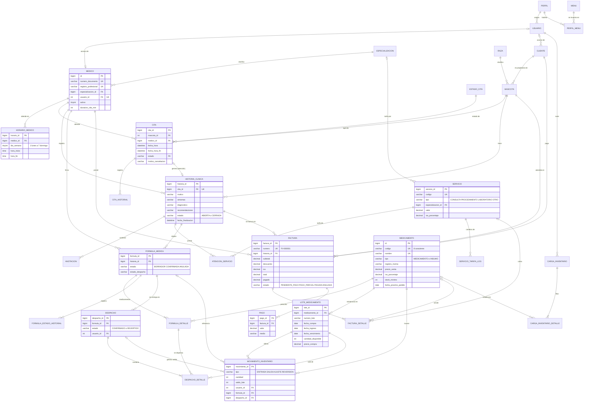

# Modelo de datos — Clínica Veterinaria Uniminuto

Base de datos MySQL `clinica` (InnoDB, `utf8mb4_unicode_ci`).

- **Esquema completo con datos de ejemplo:** `backend/database/clinica.sql`.
- **Cambios del examen final:** `backend/database/migracion_examen_final.sql`, en ocho secciones.
- **Cambios del segundo parcial:** `backend/database/migracion_segundo_parcial.sql`.

## Diagrama entidad-relación

GitHub y la mayoría de editores dibujan este diagrama (Mermaid). Para exportarlo como imagen, basta con
pegar el bloque en <https://mermaid.live>.

Por legibilidad, el diagrama solo detalla los atributos de las tablas principales; el detalle completo de cada
tabla está en `clinica.sql`.

## Restricciones e integridad

- **Llaves foráneas.** Todas las relaciones del diagrama son llaves foráneas reales, por lo que no se puede
  borrar un registro que otro esté usando. Los registros clínicos y contables nunca se borran: se anulan, se
  cancelan o se inactivan.
- **Unicidad.** Son únicos:
  - del producto: el código y el nombre;
  - del veterinario: el documento y el registro profesional;
  - la cita de cada historia clínica (una atención por cita);
  - el número de factura;
  - el código del servicio;
  - el par perfil/menú.
- **Validaciones `CHECK` en la base:**
  - cantidades y valores mayores que cero o no negativos;
  - IVA entre 0 y 100 %;
  - la cita termina después de empezar (`fecha_hora_fin > fecha_hora`);
  - la franja horaria termina después de empezar y el día de la semana va de 1 a 7;
  - estados válidos de cita, fórmula, despacho, factura, pago y carga;
  - en la factura, el descuento no supera el subtotal y lo pagado no supera el total.
- **Reglas que valida el backend** (no se pueden expresar con una sola restricción de la base):
  - **Citas sin cruces:** un veterinario no tiene dos citas que se crucen en el tiempo, ni una mascota dos citas
    simultáneas. Las canceladas no ocupan horario.
  - **Agenda:** no se agenda fuera del horario del veterinario ni con veterinarios inactivos.
  - **Tarifas:** solo puede haber una consulta activa por especialidad.
  - **Facturación:** una atención solo puede tener una factura vigente. Las anuladas se conservan y la
    atención puede volver a facturarse.
  - **Inventario:** nunca queda negativo.
- **Concurrencia.** Las operaciones críticas bloquean las filas que modifican (`PESSIMISTIC_WRITE`):
  - el despacho, sobre la fórmula y los lotes;
  - los pagos y la anulación, sobre la factura;
  - la generación de la factura, sobre la atención.
  Así, dos usuarios a la vez no descuentan dos veces el inventario ni facturan dos veces la misma atención.

## Justificación de los cambios

| Cambio | Motivo |
|---|---|
| `medicamento`: código, tipo, Invima, precio de venta, IVA, stock mínimo, próximo pedido, activo | Inventario funcional (1.1, 1.2). El Invima es obligatorio solo para medicamentos. |
| `lote_medicamento` (fechas de compra, ingreso y vencimiento movidas aquí) | Un mismo producto tiene varios lotes con precio de compra y vencimiento propios (1.2). |
| `movimiento_inventario` | Historial de entradas y salidas con usuario, fecha, fórmula y despacho (1.3, 5.4). |
| `perfil`, `menu`, `perfil_menu` y `usuario.perfil_id` | Menús por perfil y el perfil `DESPACHO_MEDICO` (5.1). El rol se lee de la base en cada petición. |
| `formula_detalle` y `formula_estado_historial` | Fórmulas con varios medicamentos e historial de estados (3.3, 5.5). |
| `despacho` y `despacho_detalle` | Entregas parciales por lote, reversión con motivo y trazabilidad (5.3 a 5.6). |
| `estado_cita`, `cita.fecha_hora_fin`, `cita_historial` | Calendario por rangos, colores por estado e historial; las canceladas conservan su historia (2.1 a 2.3). |
| `medico.activo`, `medico.duracion_cita_min`, `horario_medico` | No se agendan citas con veterinarios inactivos ni fuera de su disponibilidad (2.3, 2.4). |
| `especializacion.activo`, `servicio` y `servicio_tarifa_log` | Tarifas configurables sin cambiar el código, con IVA e historial de cambios (3.1). |
| `historia_clinica`: síntomas, recomendaciones y fecha de finalización; `atencion_servicio` | Atención de la cita con servicios prestados y su tarifa congelada (3.2). |
| `factura`, `factura_detalle`, `pago` | Facturas con valores congelados, IVA por línea, descuentos, pagos parciales y anulación controlada (3.4, 3.5). |
| `carga_inventario` y `carga_inventario_detalle` | Log de cargue: usuario, fecha, resultado y motivo por fila (1.4). |
